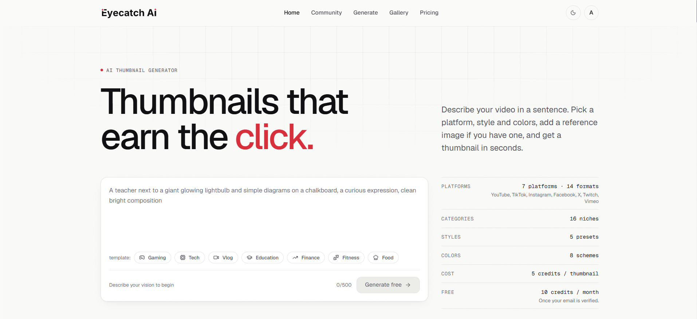

# Eyecatch AI

AI thumbnail generator for YouTube, TikTok, Instagram, Facebook, X, Twitch and Vimeo. Describe your video, pick a platform, category, style and colors, optionally add a reference image, and Google Gemini generates the thumbnail.

**Live:** https://eyecatch.zeeshanahmed.dev



> **Payments are in test mode.** This is a portfolio project: checkout runs in the Paddle sandbox and no money is charged. Use the test card `4242 4242 4242 4242` (any future expiry date, security code `100`). Credits you buy show in Settings but can't be spent; generations use the 10 free monthly credits you get after verifying your email.

## Features

- **Generate:** 14 platform formats (YouTube video and Shorts, TikTok, Instagram post, Reel and Story, Facebook video and post, X, Twitch, Vimeo, plus square, 4:3 and 3:4), 16 categories, 5 styles, 8 color schemes, an optional reference image (your face, a product, or a thumbnail whose layout you like, up to 2 MB), and text on the image on or off.
- **Prompt help:** niche templates, and an Improve button that rewrites a rough idea into a detailed prompt.
- **Gallery:** your thumbnails, with filters, sorting, publishing and downloads.
- **Community:** published thumbnails with search, likes and Trending, Newest and Most liked sorts.
- **YouTube preview:** see a thumbnail next to real-looking videos on the home feed, in search and on mobile, in light or dark mode.
- **Share links:** each one shows the thumbnail as the link preview on social media.
- **Recycle bin:** restore deleted thumbnails within 30 days.
- **Accounts:** email signup with a verification code, password reset by email, profile and avatar, and account deletion.
- **Credits and billing:** 10 free credits a month (5 per thumbnail). Pro and Ultra plans and one-time credit packs run through Paddle, in test mode.
- Light and dark theme.

## Tech stack

| | |
|---|---|
| **Client** | React 19, TypeScript, Vite, Tailwind CSS v4, TanStack Query, TanStack Form + Zod, Zustand, React Router 7, Motion, GSAP |
| **Server** | Node.js, Express 5, TypeScript, MongoDB with Mongoose 9, Zod |
| **Services** | Google Gemini (images and text), Cloudinary (image storage), Paddle Billing (sandbox), SMTP email |
| **Hosting** | Client on Vercel, API on an Oracle Cloud instance behind Nginx |

## Project structure

```
client/   React app (Vite), see client/README.md
server/   Express API, see server/README.md
```

Each folder has its own `package.json`. There is no root package.

## Run it locally

You need Node.js 20 or newer, a MongoDB database, a Gemini API key, a Cloudinary account and SMTP credentials. Paddle is optional; without it, only checkout fails.

```bash
git clone https://github.com/zeeshanahme-d/Ai-thumbnail-generator.git
cd Ai-thumbnail-generator

# API on http://localhost:8000
cd server
cp .env.example .env      # fill in the values
npm install
npm run dev

# App on http://localhost:5173 (in a second terminal)
cd client
cp .env.example .env
npm install
npm run dev
```

## Engineering highlights

- **Credits can't be overspent.** They're charged in a single atomic MongoDB update before Gemini is called. A failed generation is refunded, and a generation cut off by a crash is cleaned up and refunded by a scheduled job.
- **Auth:** tokens live in httpOnly, SameSite=Strict cookies. Each refresh issues a new refresh token, and reusing an old one signs out every device in that login. Changing the password revokes all sessions instantly.
- **Billing webhooks are verified and idempotent.** Each event's signature is checked, and a retried or out-of-order event is never applied twice.
- **Security:** uploads are checked by their actual file bytes, not their names. Database queries can't be injected through request values. Endpoints are rate-limited, and only the site itself may send write requests.
- **Data:** the API only sends the fields the app needs. Private fields such as Cloudinary IDs never leave the server.

## Author

Zeeshan Ahmed: [GitHub](https://github.com/zeeshanahme-d)
